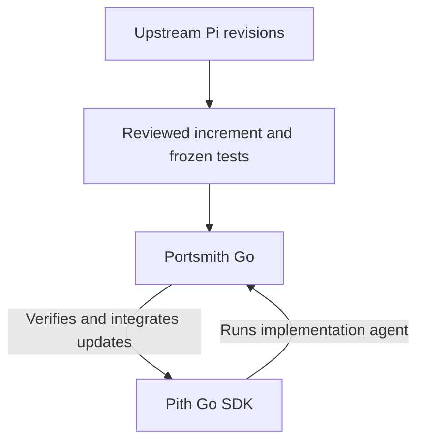

I used Pi to help port selected Pi components from TypeScript to Go. Then I used the resulting Go SDK, Pith, to power the tool that performs later Pi-to-Pith updates.

That second part was the experiment I wanted to run after the first migration. Translating a pinned version gives you a starting point. Upstream keeps changing, and the Go implementation acquires its own callers, tests, and design choices. How do you update it without treating every release as another rewrite?

[My first report](../porting-pi-to-go-with-portsmith/) covered the initial migration: a TypeScript workbench called Portsmith, powered by Pi Coding Agent, accepted 26 steps across AI, agent core, and tools. It ended with a plan to let Pith help maintain Pith. This follow-up covers the Go executor and two accepted upstream increments that followed.

The result is a bootstrapped maintenance workflow. Pith runs the implementation agent inside Portsmith Go; Portsmith Go checks and integrates updates to Pith. A developer or an external coding assistant still prepares and reviews the behavior contracts and acceptance tests.

## Moving the migration executor to Pith

[Portsmith Go](https://github.com/minifish-org/portsmith-go) is a Go port of the original migration workbench. Its [original acceptance receipt](https://github.com/minifish-org/portsmith-go/blob/710f8b91843d691ecb00fd7d0a8bf9c3354ab3ae/migration/results/portsmith.json) records seven accepted steps, delivered in commit [`710f8b9`](https://github.com/minifish-org/portsmith-go/commit/710f8b91843d691ecb00fd7d0a8bf9c3354ab3ae). The original TypeScript executor produced that port. Incremental sync and integration repair were subsequent native Go additions.

The important change is in the execution backend. In [`agent.go`](https://github.com/minifish-org/portsmith-go/blob/932b7c3e68379c7349074809bff00ae2d9b20faf/internal/portsmith/agent.go#L590), `RunPort` opens a durable Pith session, constructs a tool registry, and calls `codingagent.CreateAgentSession`. It supplies the selected model, resources, session manager, and retry and compaction policy. This is a library call inside the Go process.

The agent gets Pith's native read, write, edit, shell, and search tools, plus Portsmith's `verify_candidate` tool. It can implement a candidate, receive compiler and independent-test diagnostics, and repair the code in the same conversation. Portsmith owns acceptance, integration, and commits. The agent's final message is not the acceptance decision.



This is the bootstrap: the migrated runtime becomes a dependency of the tool that updates that runtime. It also creates a practical version boundary. Portsmith Go links a pinned Pith revision through `go.mod`; accepting new Pith source does not replace the executor already running. Updating the consumer's dependency and rebuilding it is a separate step.

The Go product runs without a Node or Pi installation. It still needs Go and Git to compile, verify, and integrate target projects. Its TypeScript analyzer embeds the TypeScript compiler in Goja, a JavaScript interpreter implemented in Go. The analyzer has not itself been rewritten as a Go TypeScript compiler.

## Two accepted upstream increments

The Pith history contains two useful milestones after the initial port. Dates below use Singapore time, UTC+8.

| Accepted commit | Date | Upstream revision | Scope |
| --- | --- | --- | --- |
| [`0044a03`](https://github.com/minifish-org/pith/commit/0044a030ed7a2f4f60dde3f486965bbb182c6edf) | October 1, 2026 | `002fc8385268` | Three steps for provider stream events, agent observation, and SDK observation |
| [`2f7f735`](https://github.com/minifish-org/pith/commit/2f7f735997b70395888e222a24bc44756119a500) | October 3, 2026 | `a13d35a742c6` | Nine steps for the selected Pi 1.0 SDK capabilities |

The first increment exercised the route from provider adapters through the agent and into the embedded SDK. Its [receipt](https://github.com/minifish-org/pith/blob/0044a030ed7a2f4f60dde3f486965bbb182c6edf/migration/results/pi-002fc8385268.json) identifies `portsmith-native-go-v1` as the verifier. It was already using the native Go workflow.

The Pi 1.0 increment expanded the scope substantially. Its [reviewed plan](https://github.com/minifish-org/pith/blob/2f7f735997b70395888e222a24bc44756119a500/migration/sync/pi-1.0/README.md) covered model foundations and catalogs, model operations, streaming protocols, authentication, agent core, MCP, Codemode, SDK integration, and delivery.

The [workflow](https://github.com/minifish-org/pith/blob/2f7f735997b70395888e222a24bc44756119a500/migration/sync/pi-1.0/workflow.json) authorized changes to **234 existing files**, kept **815 baseline files read-only**, and named **26 independent acceptance tests** across nine steps. Those counts describe the prepared scope: they are not a count of files actually changed or proof that every upstream behavior was covered.

The [final receipt](https://github.com/minifish-org/pith/blob/2f7f735997b70395888e222a24bc44756119a500/migration/results/pi-a13d35a742c6.json) records all nine steps. Both increment receipts report successful compilation, vet, candidate tests, and independent behavior tests. Both retain `fullParityProven: false`. Unlike the original Portsmith Go port receipt, these two final increment receipts do not list a race phase.

The accepted code commit and the upstream-baseline commit are distinct. After the Pi 1.0 module was accepted, [`a569953`](https://github.com/minifish-org/pith/commit/a569953ad8f8ac9daa40f90b509c224c6d195df7) advanced the tracked revision. This distinction matters when execution is interrupted between delivering code and recording the next starting point.

## Finding the Go code affected by an upstream change

An incremental port needs more than a diff. A TypeScript file may map to several Go packages, and a shared type change can affect code that upstream did not edit directly.

Portsmith Go keeps explicit source ownership: each watched TypeScript source maps to its Go outputs. Initialization imports existing migration records and source maps; that ownership is reviewed and committed before preparing a new increment. Reference-only inputs are tracked separately so that a changed reference does not automatically authorize edits to unrelated implementation files.

The [`sync` implementation](https://github.com/minifish-org/portsmith-go/blob/932b7c3e68379c7349074809bff00ae2d9b20faf/internal/portsmith/sync.go#L790) analyzes both the old and new source trees and builds a reverse import graph. It starts with changed sources and follows their dependents. Looking at both revisions matters for removed imports and deleted files. Configuration JSON changes conservatively include all mapped source.

That produces a draft containing exact changes, affected sources, unmapped inputs, and proposed Go output ownership. It makes no model calls at this stage. A reviewer then resolves the semantic questions: which behavior changes, which APIs remain compatible, which new sources need owners, and which upstream changes are outside the chosen SDK scope.

One concrete decision in the Pi 1.0 [core contract](https://github.com/minifish-org/pith/blob/2f7f735997b70395888e222a24bc44756119a500/migration/sync/pi-1.0/contracts/core.md) was to retain Pith's existing experimental harness and compatibility APIs even though upstream had removed its harness. Upstream deletion did not authorize deleting APIs already exposed by the Go library. Durable was deferred from this particular increment.

That is why I want a reviewed migration plan between the diff and the implementation agent. A source dependency graph can identify likely impact. It cannot decide the compatibility policy for downstream applications.

## Protecting existing code and acceptance tests

The initial migration mostly created outputs. An increment must replace existing implementation while preserving everything outside its reviewed scope.

Version-2 workflows separate existing files into two sets. `baseline.files` are frozen dependencies. `updates.files` are existing files explicitly authorized for replacement. Both are tied to a target Git commit and content hashes. Independent judges, manifests, and historical receipts stay outside the writable update set.

The candidate begins with the authorized original implementation. Other baseline material is available as read-only input. Verification runs the frozen independent tests alongside candidate self-tests; later steps accumulate the earlier acceptance gates. Passing a later step does not allow the implementation agent to weaken an earlier contract.

For Pi 1.0, the acceptance tests ask specific questions: do model identities distinguish operation kinds, do nested tool hooks preserve structured replacements, can MCP transports return the expected content, and does deferred tool activation compose with SDK routing? Those questions are narrow enough to execute. Their value depends on how well the reviewer chose them.

Hashes and ownership checks protect the workflow's inputs and integration decisions. They do not turn a model-controlled shell into an operating-system sandbox. The executor runs in the local user's environment.

## Repairing a candidate that fails after integration

An isolated candidate can pass its own acceptance suite and still break an existing caller. Portsmith Go gained automatic whole-project integration repair in [`8055d84`](https://github.com/minifish-org/portsmith-go/commit/8055d84e69775f8f8b3cd355b9bb4460a170b978), on October 3, after the Pi 1.0 acceptance commit. This is a later executor improvement, separate from the evidence in those two increment receipts.

When the target project's regression suite fails, the executor archives the diagnostics and persists a rollback transaction. It restores recorded original files, removes recorded additions, and reopens the final implementation step with the failure as feedback. Earlier accepted checkpoints remain. The repaired candidate must pass cumulative acceptance and the project suite before the module is committed.

The [`TestWorkflowV2IntegrationFailureRepairsCandidate` regression](https://github.com/minifish-org/portsmith-go/blob/932b7c3e68379c7349074809bff00ae2d9b20faf/internal/portsmith/integration_repair_test.go#L113) makes this boundary visible. A two-step candidate passes isolated checks but misses a marker required by a historical project test. The deterministic generator adds that marker during repair. The test checks that the first step stays accepted, the historical test is unchanged, the failure report survives, and exactly one module commit is created.

This fixture tests the executor's recovery behavior without asking a live model to reproduce a particular mistake. A separate [Pith backend test](https://github.com/minifish-org/portsmith-go/blob/932b7c3e68379c7349074809bff00ae2d9b20faf/internal/portsmith/portsmith_judge_backend_test.go) drives failure diagnostics, a file repair, successful verification, and session resume through the actual Pith tool loop using a deterministic model stream.

Recovery must also distinguish interrupted work from an external edit. It accepts the recorded old bytes or verified new bytes; an unexpected third hash stops recovery and preserves the edit. Tests cover this refusal and recovery of the separate metadata commit. A recovery mechanism that overwrites unrelated work would be a poor trade for automation.

## Trying the workflow

The [incremental migration guide](https://github.com/minifish-org/portsmith-go/blob/932b7c3e68379c7349074809bff00ae2d9b20faf/docs/INCREMENTAL.md) documents initialization, ownership, review, execution, and recovery. For a project with a committed sync configuration, the sequence is:

```sh
# Build Portsmith Go from its checkout.
CGO_ENABLED=0 go build -mod=readonly -trimpath -o bin/portsmith ./cmd/portsmith

# Prepare a draft for a chosen full upstream Git commit.
./bin/portsmith sync --project ../target --upstream <full-upstream-commit>

# Review and complete the draft's ownership, contracts, and independent tests.
# Check the prepared plan without making model calls.
./bin/portsmith sync --project ../target --upstream <full-upstream-commit> --check

# Execute with local provider credentials and commit accepted results.
./bin/portsmith sync --project ../target --upstream <full-upstream-commit> \
  --commit --env-file .env
```

The default draft preparation exits with code 2 when review is needed. That is an expected preparation state. The execution command resumes from durable progress when repeated; a partial run keeps the old accepted upstream baseline. Git push remains an operator action.

These commands describe the workflow for an existing configured target. Repeating the historical Pi 1.0 run requires the pinned starting tree and reviewed materials, rather than today's already-updated Pith checkout.

## What the bootstrap gives me

The two increments establish something more useful than another successful translation: the Go runtime can execute a real migration tool, and that tool can apply reviewed upstream updates to the runtime itself. Maintenance now has explicit source ownership, acceptance gates, checkpoints, and a recorded starting revision for the next increment.

The same SDK has a separate consumer in [Pith Desk](https://github.com/minifish-org/pith-desk). Its [run execution code](https://github.com/minifish-org/pith-desk/blob/828629d31f462bc5240206958d7a23170866f022/internal/desk/run_execution.go#L172) also constructs a Pith agent session directly. Portsmith Go tests the SDK as a migration engine; Desk uses it as a desktop application's runtime. That makes compatibility decisions consequential beyond the migration repository.

I have included a compact [evidence summary](incremental-migration-evidence.json) with pinned commits, receipt hashes, acceptance phase results, plan counts, and the focused offline checks run for this report. The original receipts and reviewed plans remain linked above. The checks prove the exercised behaviors; neither a complete receipt nor the bootstrap establishes full Pi compatibility or reliable unattended handling of every future change.

The next question for me is how much judgment can be made reusable. Source mappings and recovery can be mechanized. Deciding what a changed upstream behavior should mean for existing Go callers still requires a contract. The useful measure is whether the next reviewed increment can preserve those callers and leave enough evidence to explain why it was accepted.
